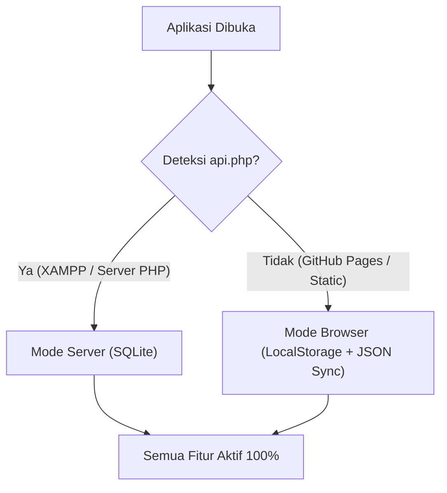

# ContentFlow 📱✨
### *Free, Powerful & Open-Source Social Media Content Planner & Pipeline*

[](LICENSE)
[](#-cara-hosting-gratis-di-github-pages-0-biaya)
[-blue.svg)](#-arsitektur-dual-storage-engine)
[](#-fitur-unggulan)

**ContentFlow** adalah aplikasi manajemen dan perencanaan konten media sosial yang fleksibel, modern, dan gratis selamanya. Didesain dengan arsitektur **Dual-Engine** sehingga dapat di-host langsung secara **gratis 100% di GitHub Pages** (tanpa butuh server/database berbayar), sekaligus bisa dijalankan secara lokal di **XAMPP / PHP + SQLite**.

---

## 🌟 Fitur Unggulan

| Fitur | Deskripsi |
|---|---|
| **📊 Dashboard & Analitik** | KPI total konten, scheduled, published, reach, serta grafik interaktif distribusi platform & pilar konten (Chart.js). |
| **📅 Kalender Konten Interaktif** | Kalender bulanan visual dengan navigasi tanggal, badge warna platform, dan klik tanggal untuk langsung jadwalkan konten. |
| **📋 Kanban Pipeline Board** | Drag-and-drop workflow 6 tahap: *Ide &rarr; Scripting &rarr; Produksi &rarr; Review &rarr; Terjadwal &rarr; Published*. |
| **📑 Tabel & Filter Canggih** | Filter multi-kategori (Platform, Status, Pilar) dan pencarian live search real-time. |
| **💡 Bank Ide (Idea Vault)** | Simpan ide konten spontan dan konversi jadi draf konten dengan 1 klik. |
| **⚡ Hooks & Copywriting Helper** | Koleksi 13+ Formula Hook 3 Detik Pertama, formula copywriting (AIDA, PAS, BAB), dan preset hashtag per niche. |
| **📱 Simulasi Mockup Ponsel** | Pratinjau realistis tampilan feed/reels/video smartphone sebelum diposting. |
| **💾 Backup & Restore (JSON & CSV)** | Export/Import seluruh database planner dalam format JSON & CSV, aman dipindahkan antar perangkat. |
| **📲 PWA & Offline Support** | Dapat diinstall sebagai aplikasi desktop/mobile dan digunakan tanpa internet. |

---

## 🚀 Cara Hosting Gratis di GitHub Pages (0 Biaya)

Anda bisa meng-online-kan aplikasi ini ke internet secara **gratis 100%** menggunakan **GitHub Pages**:

1. **Buat Repository Baru di GitHub**:
   - Masuk ke akun [GitHub](https://github.com/) Anda.
   - Klik **New Repository**, beri nama misalnya `contentflow` atau `content-planner`.
   - Pilih **Public**.

2. **Upload Berkas Aplikasi ke GitHub**:
   - Push atau upload seluruh file proyek ini (`index.html`, `manifest.json`, `LICENSE`, `assets/`, dll.) ke branch `main`.
   ```bash
   git init
   git add .
   git commit -m "feat: initial commit ContentFlow"
   git branch -M main
   git remote add origin https://github.com/USERNAME/content-planner.git
   git push -u origin main
   ```

3. **Aktifkan GitHub Pages**:
   - Di halaman repository GitHub Anda, buka tab **Settings** &rarr; menu **Pages** (di sidebar kiri).
   - Pada bagian **Build and deployment** &rarr; **Source**: pilih **Deploy from a branch**.
   - Pada bagian **Branch**: pilih `main` dan folder `/ (root)`, lalu klik **Save**.

4. **Selesai! 🎉**
   - Dalam 1-2 menit, aplikasi Anda sudah live di URL:
   - 👉 `https://USERNAME.github.io/content-planner/`
   - *Semua orang di seluruh dunia dapat langsung menggunakannya secara gratis tanpa perlu setup database apapun!*

---

## 💻 Cara Menjalankan Secara Lokal (XAMPP / PHP)

Jika ingin menjalankan secara lokal di komputer Anda menggunakan server PHP + SQLite:

1. Letakkan folder ini di dalam direktori `c:\xampp\htdocs\content planner`.
2. Buka terminal atau PowerShell, lalu jalankan:
   ```bash
   php -S localhost:8000
   ```
   *Atau jalankan Apache di XAMPP Control Panel dan akses `http://localhost/content%20planner/`.*
3. Buka browser di **[http://localhost:8000](http://localhost:8000)**.

---

## 🧠 Arsitektur Dual Storage Engine

Aplikasi ini dilengkapi dengan deteksi otomatis (*auto-detection*):



- **Mode GitHub Pages (Client-side)**: Data tersimpan aman di browser masing-masing pengguna menggunakan HTML5 `LocalStorage` dan gambar diubah otomatis menjadi Base64. Pengguna bisa melakukan *Backup JSON* kapan saja untuk memindahkan data ke perangkat lain.
- **Mode Server (PHP + SQLite)**: Data tersimpan di file database lokal `database.sqlite` dan file upload di folder `uploads/`.

---

## 📁 Struktur Direktori
```text
content planner/
├── index.html          # Entry point untuk GitHub Pages & hosting statis
├── index.php           # Entry point untuk lingkungan XAMPP / PHP server
├── api.php             # REST API backend (PHP + SQLite)
├── db.php              # Inisialisasi database SQLite & auto-seed data
├── database.sqlite     # Database SQLite (hanya dipakai di mode PHP)
├── manifest.json       # Konfigurasi PWA (Web App Installable)
├── LICENSE             # Lisensi Open Source MIT
├── README.md           # Dokumentasi resmi
├── uploads/            # Direktori gambar thumbnail (mode PHP)
└── assets/
    ├── app.css         # Styling kustom & simulasi mockup smartphone
    └── app.js          # Core JS: Dual Storage, Kanban Sortable, Chart.js, Hooks
```

---

## 📄 Lisensi
Didistribusikan di bawah lisensi **MIT License**. Gratis digunakan, dimodifikasi, dan dibagikan oleh siapa saja untuk kebutuhan pribadi maupun komersial.
